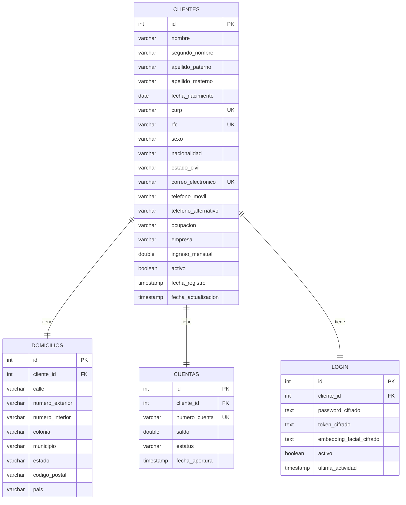

# Integración de Clientes API — Onboarding de Clientes Personas Físicas

## Objetivo
Registrar clientes personas físicas, validar su información de forma estricta, crear
automáticamente una cuenta bancaria con saldo inicial, y proteger el acceso mediante login
con contraseña y/o reconocimiento facial, todo cifrado en base de datos.

## Diagrama entidad-relación



## Script de creación de base de datos
`src/main/resources/db/migration/V3__create_clientes_schema.sql` — aplicado automáticamente
por Flyway al arrancar la aplicación. Renombra la tabla original `personas` a `clientes`,
agrega todos los campos nuevos, y crea `domicilios`, `cuentas` y `login` con sus llaves
foráneas, restricciones únicas e índices.

## Decisiones técnicas

**Tipos de dato — lo más ligero posible:**
- `ingreso_mensual`, `saldo` → `double` (no `decimal`, para no cargar memoria extra en un
  proyecto académico sin necesidad de precisión bancaria estricta). El ingreso se valida
  con un máximo de 2 decimales.
- `codigo_postal` → `VARCHAR(5)`, **no `int`** — un CP puede empezar en 0 y un entero
  perdería ese dígito.
- Password, token y embedding facial → `TEXT` (más ligero que `VARCHAR` con longitud fija,
  ya que el contenido cifrado varía en tamaño).

**Cifrado (AES, vía `spring-security-crypto`):**
Password, token de sesión y el vector de embedding facial se cifran con
`TextEncryptor` (AES) antes de guardarse — nunca se persiste texto plano. La clave y el
salt se inyectan por variables de entorno (`APP_ENCRYPTION_PASSWORD`,
`APP_ENCRYPTION_SALT`), nunca hardcodeadas.

**Reconocimiento facial — sin procesar imágenes en el backend:**
MediaPipe Face Detection/Embedding no tiene SDK maduro para Java/Spring Boot. El backend
nunca recibe ni procesa imágenes: el cliente (navegador/app) captura el rostro y genera el
vector de embedding (con MediaPipe o `face-api.js`, ambos gratuitos), y solo envía ese
vector numérico. El backend lo cifra, lo guarda, y para verificar login compara distancia
euclidiana entre el vector guardado y el recibido (umbral configurado en
`LoginServiceImpl.UMBRAL_DISTANCIA_FACIAL`).

**Sesión activa con apagado automático:**
Al iniciar sesión (`activarSesion`), `Login.activo=true` y se registra `ultimaActividad`.
Un job programado (`@Scheduled(fixedRate = 60000)`) revisa cada minuto todas las sesiones
activas y apaga (`activo=false`) las que llevan más de 5 minutos sin actividad
(`PUT /login/actividad`, con el id del cliente en el cuerpo, se debe llamar en cada request
autenticado del frontend para "refrescar" la sesión).

**Todo en Postgres, nada en Redis:** Cliente, Domicilio, Cuenta y Login son JPA
repositories normales contra Postgres — completamente independientes del módulo de cache
de Redis usado por GestoPago.

## Convenciones de la API (requisitos del profesor)
| Requisito | Cómo se cumple |
|---|---|
| Sin `@PathVariable` ni `@RequestParam` | Ningún endpoint los usa. Todo dato (id, criterios de búsqueda, número de cuenta, filtros) viaja en el cuerpo JSON con `@RequestBody` |
| Un solo endpoint de búsqueda con filtros combinables | `POST /clientes/buscar` recibe un `BuscarClienteRequest`; los criterios enviados se combinan con "y" |
| `@Valid` sobre los DTO | Todos los controladores reciben DTO anotados y los validan con `@Valid`; no hay validaciones repetidas en los controladores |
| Manejo centralizado de errores | `GlobalExceptionHandler` (`@RestControllerAdvice`) con un `@ExceptionHandler` por tipo de excepción; los controladores no tienen `try-catch` |
| Excepciones propias de negocio | `ClienteNoEncontradoException`, `CorreoDuplicadoException`, `CurpDuplicadaException`, `ValidacionNegocioException`… |
| Separación Controller / Service / Repository / DTO / Entity | Arquitectura por capas; los controladores no devuelven ni reciben entidades JPA |
| Campos controlados por el servidor | `id`, `activo`, `fechaRegistro`, saldo y estatus de cuenta no existen en los DTO de entrada, por lo que el cliente no puede fijarlos; en la actualización, CURP, RFC, sexo, fecha de nacimiento y número de cuenta se rechazan si llegan |
| Actualizar con `Optional` | `actualizaCliente` localiza al cliente con `Optional.ofNullable(id).flatMap(findById).orElseThrow(...)` y asigna cada campo solo si viene (`Optional.ofNullable(valor).ifPresent(...)`); lo omitido no se toca |
| Consultas dinámicas con Spring Data JPA | `ClienteSpecs` define un filtro por criterio (`Specification`) y el servicio combina solo los que vienen en la petición |
| Estructura uniforme de respuestas | Éxito y error usan `GenericResponse` (ver "Formato de respuestas") |
| Códigos de estado adecuados | 201 al crear; 200 en consultas, actualización y baja; 400, 401, 404, 409… según el error |
| Sin trazas ni SQL al cliente | El handler genérico registra el detalle en el log y responde un mensaje sin información interna |

## Validaciones de entrada

La validación ocurre **en tres capas**, de modo que un dato inválido se detiene lo antes
posible y nunca llega a la base de datos:

1. **Deserialización (JSON):** el tipo de dato debe coincidir (texto, número, fecha, booleano).
2. **Controller (Bean Validation):** el cuerpo se valida con `@Valid` contra las
   anotaciones del DTO (`@NotBlank`, `@Pattern`, `@Size`, `@Curp`, `@Rfc`, `@CodigoPais`…).
   Un RFC o una CURP inválidos se rechazan **antes de entrar al service**.
3. **Service:** reglas de negocio (mayoría de edad, duplicados, existencia del cliente).

Todos los errores se responden con el mismo formato (ver "Formato de respuestas").

### Formato de fecha
Las fechas se envían y se devuelven como **`yyyy/MM/dd`** (ejemplo: `1995/05/18`); la
fecha y hora de registro se devuelve como `yyyy/MM/dd HH:mm:ss`.
La lectura es estricta: `1995-05-18`, `1995/5/18`, `18/05/1995` o `1995/02/30` se rechazan
con el mensaje *"debe ser una fecha con formato yyyy/MM/dd (ejemplo: 1983/05/18)"*.
Aplica a `fechaNacimiento` y a los criterios `fechaRegistroDesde` y `fechaRegistroHasta` de
`POST /clientes/buscar`.

### Catálogos
| Catálogo | Endpoint | Fuente | Valores |
|---|---|---|---|
| Géneros | `GET /catalogos/generos` | Enum `Genero` | `H` Hombre, `M` Mujer, `X` No binario, `O` Otro, `N` Prefiero no decirlo |
| Nacionalidades / países | `GET /catalogos/nacionalidades` | API REST Countries v5 | Código ISO de 2 letras (`MX`) y nombre en español |

El catálogo de nacionalidades se consulta a la API de países (requiere la variable
`RESTCOUNTRIES_API_KEY`), se guarda en memoria con vigencia configurable
(`RESTCOUNTRIES_CACHE_HOURS`, 24 h por defecto) y, si la API no responde o no hay key, se
usa como respaldo la lista ISO de Java en español. `nacionalidad` y `pais` se validan
contra este catálogo con la anotación `@CodigoPais`.

### Estructura de la CURP (18 caracteres)
| Posiciones | Contenido | Regla |
|---|---|---|
| 1–4 | Letras del nombre | 4 letras; la segunda es vocal o `X` |
| 5–10 | Fecha de nacimiento `AAMMDD` | Fecha real, no futura |
| 11 | Sexo | `H`, `M` o `X` (no binario) |
| 12–13 | Entidad federativa | Clave del catálogo oficial (`GT`, `JC`, `DF`… y `NE` para nacidos en el extranjero) |
| 14–16 | Consonantes internas | 3 consonantes |
| 17 | Homoclave | Número si nació antes del 2000, letra del 2000 en adelante |
| 18 | Dígito verificador | Calculado con las 17 posiciones anteriores |

Cada parte tiene su propio mensaje de error (ejemplo: *"El dígito verificador de la CURP
es incorrecto (debería ser 8)"*). Implementado en `CurpValidador` y expuesto con `@Curp`.

### Estructura del RFC
| Tipo | Longitud | Estructura |
|---|---|---|
| Persona física | 13 | 4 letras (la 2.ª vocal o `X`, se permite `Ñ`) + fecha `AAMMDD` + homoclave (2) + dígito verificador |
| Persona moral | 12 | 3 letras (se permite `&`) + fecha de constitución `AAMMDD` + homoclave (2) + dígito verificador |
| Genéricos del SAT | 13 | `XAXX010101000` (público en general) y `XEXX010101000` (extranjeros), aceptados como persona física |

El dígito verificador es un número del 0 al 9 o la letra `A`. Implementado en
`RfcValidador` (`FISICA`, `MORAL` o `CUALQUIERA`) y expuesto con `@Rfc`. Como este
onboarding es de **personas físicas**, el registro exige 13 caracteres; si llega un RFC de
12 caracteres se rechaza indicando que corresponde a una persona moral.

### Validaciones cruzadas del registro
- La fecha de nacimiento debe coincidir con la que contiene la **CURP**.
- La fecha de nacimiento debe coincidir con la que contiene el **RFC**.
- El sexo debe coincidir con la posición 11 de la CURP (`O` y `N` se aceptan con cualquiera).
- Las 4 primeras letras del RFC deben coincidir con las de la CURP.
- La fecha de nacimiento debe ser posterior al 1900/01/01 y el cliente mayor de 18 años.

### Normalización
Antes de guardar o consultar: CURP y RFC se recortan y pasan a **mayúsculas**; el correo
se pasa a **minúsculas**; los códigos de país a mayúsculas; los textos se recortan; y los
campos opcionales enviados vacíos se guardan como `null`.

### Reglas por campo (registro)
| Campo | Obligatorio | Regla |
|---|---|---|
| `nombre`, `apellidoPaterno`, `apellidoMaterno` | Sí | 2–50 caracteres, solo letras (con acentos y Ñ) y un espacio entre palabras |
| `segundoNombre` | No | Hasta 50, solo letras y espacios |
| `fechaNacimiento` | Sí | `yyyy/MM/dd`, pasada, posterior a 1900 |
| `curp` | Sí | `@Curp` |
| `rfc` | Sí | `@Rfc` (persona física) |
| `sexo` | Sí | `H`, `M`, `X`, `O` o `N` |
| `nacionalidad` | Sí | `@CodigoPais` |
| `estadoCivil` | Sí | Soltero(a), Casado(a), Divorciado(a), Viudo(a), Unión libre o Separado(a) |
| `correoElectronico` | Sí | Formato de correo con dominio, máximo 100 |
| `telefonoMovil` | Sí | Exactamente 10 dígitos |
| `telefonoAlternativo` | No | Exactamente 10 dígitos |
| `ocupacion`, `empresa` | No | Máximo 50 y 100 caracteres, sin símbolos no permitidos |
| `ingresoMensual` | Sí | Número mayor a 0, hasta 2 decimales |
| `calle`, `colonia` | Sí | Máximo 100, letras, números y `. , # / ' & -` |
| `numeroExterior` | Sí | Máximo 10, alfanumérico, guion o diagonal (ej. `12-A`, `S/N`) |
| `numeroInterior` | No | Máximo 10, alfanumérico, guion o diagonal |
| `municipio`, `estado` | Sí | Solo letras |
| `codigoPostal` | Sí | Exactamente 5 dígitos |
| `pais` | Sí | `@CodigoPais` |

### Actualización (`PUT /clientes`)
El cuerpo lleva el `id` del cliente (obligatorio) y solo los campos a modificar; los demás
son opcionales, los que llegan cumplen las mismas reglas y los obligatorios no pueden quedar
vacíos. Debe enviarse al menos un campo además del `id`. **CURP, RFC, sexo,
fecha de nacimiento y número de cuenta no se pueden modificar**: si llegan en la petición
se rechazan con un mensaje claro (por ejemplo, *"La CURP no se puede modificar"*). El correo
nuevo no puede pertenecer a otro cliente.

## Reglas de negocio implementadas
- Mayoría de edad (18 años) validada con `Period.between` antes de crear el cliente.
- CURP, RFC y correo únicos — verificados contra la BD antes de insertar.
- Cuenta creada automáticamente con saldo inicial 0 y estatus `ACTIVA`, número de cuenta
  único generado con timestamp + UUID.
- Baja lógica: desactiva cliente y cuenta sin borrar filas de la BD. Dar de baja a un
  cliente ya inactivo se rechaza con un mensaje claro.

## Endpoints implementados
Todos los datos viajan en el cuerpo JSON; ningún endpoint usa parámetros de ruta ni de consulta.

| Método | Ruta | Cuerpo | Descripción |
|---|---|---|---|
| POST | `/clientes` | `ClienteRequest` | Registra cliente + domicilio + cuenta automática (201) |
| GET | `/clientes` | — | Lista todos los clientes |
| POST | `/clientes/buscar` | `BuscarClienteRequest` | **Única búsqueda**: combina los criterios enviados (al menos uno) |
| PUT | `/clientes` | `ActualizaClienteRequest` (con `id`) | Actualiza solo los campos enviados (sin CURP/RFC/sexo/fecha de nacimiento) |
| PUT | `/clientes/baja` | `{ "id": 1 }` | Baja lógica del cliente y de su cuenta |
| GET | `/catalogos/generos` | — | Catálogo de géneros |
| GET | `/catalogos/nacionalidades` | — | Catálogo de nacionalidades (API de países) |
| POST | `/cuentas/consultar` | `{ "numeroCuenta": "..." }` | Cuenta por número |
| GET | `/cuentas/activas` | — | Cuentas activas |
| POST | `/cuentas/saldo` | `{ "numeroCuenta": "..." }` | Saldo de una cuenta |
| POST | `/login/registrar` | `RegistrarCredencialesRequest` | Registra password/embedding facial (cifrados) |
| POST | `/login/iniciar-sesion` | `LoginRequest` | Login con correo y contraseña |
| POST | `/login/iniciar-sesion-facial` | `LoginFacialRequest` | Login con correo y reconocimiento facial |
| POST | `/login/cerrar-sesion` | `{ "id": 1 }` | Cierra sesión manualmente |
| PUT | `/login/actividad` | `{ "id": 1 }` | Refresca la sesión (evita el apagado a 5 min) |
| GET | `/gestopago/productos` | — | Catálogo completo de GestoPago, ordenado por precio |
| POST | `/gestopago/productos/consultar` | `{ "tipoFront": 2 }` (opcional) | Catálogo filtrado por tipo |
| POST | `/gestopago/productos/sincronizar` | — | Sincroniza el catálogo (pruebas) |

### Búsqueda de clientes (`POST /clientes/buscar`)
Criterios opcionales (debe venir al menos uno); los enviados se combinan con "y":

| Criterio | Regla |
|---|---|
| `id` | Entero positivo |
| `nombre` | 2–100 caracteres, solo letras; se busca por palabras en el nombre completo, sin distinguir mayúsculas ni acentos |
| `curp` | `@Curp` (estructura y dígito verificador) |
| `rfc` | `@Rfc` (persona física) |
| `correoElectronico` | Formato de correo, máximo 100 |
| `numeroCuenta` | 6–30 caracteres alfanuméricos |
| `sexo` | `H`, `M`, `X`, `O` o `N` |
| `nacionalidad` | Código de país del catálogo (`MX`) |
| `activo` | `true` o `false` |
| `fechaRegistroDesde`, `fechaRegistroHasta` | `yyyy/MM/dd`; "desde" no puede ser posterior a "hasta" |

Ejemplo:
```json
{ "nombre": "juana camarillo", "activo": true, "fechaRegistroDesde": "2026/01/01" }
```
Sin criterios responde 400; sin resultados responde 404 indicando los criterios usados. La
consulta se arma dinámicamente con `Specification` (`ClienteSpecs`): cada criterio presente
agrega un filtro SQL.

### Login por correo
`POST /login/iniciar-sesion` recibe `correoElectronico` y `password`, con mensajes
específicos:
- Correo no registrado → 401 *"El correo electrónico 'x@y.com' no está registrado"*.
- Contraseña incorrecta → 401 *"La contraseña es incorrecta"*.
- Cliente dado de baja → 401 *"El cliente está dado de baja y no puede iniciar sesión"*.
- Cliente sin credenciales → 404.
- En el login facial, un embedding con valores no numéricos o de otra longitud → 400.

> Nota de seguridad: distinguir "correo no registrado" de "contraseña incorrecta" permite
> saber qué correos existen (enumeración de usuarios). Se implementa así por requerimiento
> explícito del profesor.

## Formato de respuestas
Éxito y error comparten la estructura `GenericResponse`: `codigo` (0 = éxito, otro valor =
error), `mensaje` y, solo en éxito con información, `datos`.

Éxito:
```json
{ "codigo": 0, "mensaje": "Consulta realizada correctamente", "datos": [ { "id": 1, "nombre": "Juana" } ] }
```
Error:
```json
{ "codigo": 400, "mensaje": "rfc: El RFC tiene 12 caracteres, que corresponde a una persona moral..." }
```

| Situación | HTTP |
|---|---|
| Validación de campos, tipo de dato incorrecto, JSON mal formado, regla de negocio | 400 |
| Credenciales inválidas (correo, contraseña, rostro) | 401 |
| Cliente, cuenta o credenciales inexistentes; ruta inexistente | 404 |
| Método no permitido | 405 |
| CURP, RFC o correo duplicados; conflicto con la base de datos | 409 |
| Tipo de contenido no soportado | 415 |
| Error inesperado (sin detalles técnicos) | 500 |

Ejemplos de mensajes de tipo de dato: *"El campo 'ingresoMensual' debe ser un número"*,
*"El campo 'id' debe ser un número entero (sin letras ni decimales)"*.

## Manejo de excepciones personalizadas
`ClienteNoEncontradoException`, `CurpDuplicadaException`, `RfcDuplicadoException`,
`CorreoDuplicadoException`, `ClienteYaRegistradoException`, `CuentaNoEncontradaException`,
`ValidacionNegocioException`, `CredencialesInvalidasException`
(con `UsuarioNoEncontradoException` y `PasswordIncorrectaException`),
`LoginNoEncontradoException` — todas manejadas centralmente en `GlobalExceptionHandler`,
junto con las excepciones de validación y de lectura de la petición, devolviendo el HTTP
correcto y un mensaje claro, nunca un error genérico.

## Respuesta a la observación sobre la validación del RFC
| Observación | Cómo se resuelve |
|---|---|
| Acepta cadenas vacías o con espacios | `@NotBlank` y `@Rfc` rechazan vacío, solo espacios y tabuladores, tanto en el registro como en la búsqueda. Los espacios de los extremos se recortan; los internos se rechazan |
| No verifica la longitud esperada | Exige 13 caracteres (física) o 12 (moral), con mensaje que indica la longitud recibida |
| No comprueba el formato de persona física o moral | `RfcValidador` distingue ambas estructuras (letras, fecha, homoclave) y explica si el RFC corresponde al otro tipo |
| Acepta caracteres especiales | Solo letras y números (y `&` en persona moral); cualquier otro símbolo se rechaza |
| No normaliza el RFC | Se recorta y se convierte a mayúsculas antes de validar y de consultar |
| Datos inválidos llegan al service o a la base de datos | La validación ocurre en el DTO con `@Valid`, antes de entrar al service; además se verifica el dígito verificador |

## Evidencia de pruebas
- `ClienteServiceImplTest`: creación exitosa con cuenta automática, rechazo por menor de
  edad, CURP/RFC/correo duplicados, cliente no encontrado y baja lógica.
- `CurpValidadorTest`: CURP válidas (antes y después del 2000, sexo `X`) y cada tipo de
  error (dígito verificador, fecha, entidad, longitud, símbolos, sexo, letras, consonantes,
  vacío y nulo).
- `RfcValidadorTest`: RFC de persona física, moral y genéricos; longitud, fecha,
  caracteres, espacios, dígito verificador, normalización, vacío y nulo.
- `GestoPagoProductServiceImplTest`: catálogo de productos de GestoPago.

Ejecución: `./gradlew test` (todas pasan, `BUILD SUCCESSFUL`).