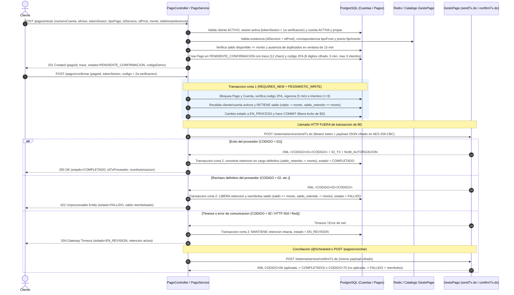

# Integración de Pagos de Servicios y Recargas con GestoPago (`sendTx.do` y `confirmTx.do`)

## 1. Objetivo y Alcance
Habilitar el procesamiento seguro de recargas de tiempo aire/pines (`RECARGA`) y pagos de recibos de servicios (`SERVICIO`) contra el proveedor **GestoPago / PuntoRed** (`POST /sistema/service/sendTx.do` y `POST /sistema/service/confirmTx.do`), aplicando doble verificación del cliente (token de sesión + código de 6 dígitos), validación estricta contra el catálogo cacheado, cifrado `AES-256-CBC` del payload y la estrategia transaccional **Retener → Cobrar → Conciliar**.

---

## 2. Contrato Oficial de GestoPago (`sendTx.do` y `confirmTx.do`)
Documentación oficial de referencia: <https://documenter.getpostman.com/view/19876210/Uz5MFtdn>.

### 2.1 Endpoints del proveedor
| Operación | Método y Ruta | Contenido de Petición | Respuesta |
|---|---|---|---|
| **Enviar transacción** | `POST /sistema/service/sendTx.do` | `application/x-www-form-urlencoded` (`random`, `signed`) + Header `Authorization: Bearer <token>` | `application/xml` (`<RESPONSE>`) |
| **Confirmar / Conciliar transacción** | `POST /sistema/service/confirmTx.do` | `application/x-www-form-urlencoded` (`random`, `signed`) + Header `Authorization: Bearer <token>` | `application/xml` (`<RESPONSE>`) |

### 2.2 Estructura del JSON antes de cifrar (`signed`)
El parámetro `signed` contiene el objeto JSON cifrado con **AES-256-CBC** (`AES/CBC/PKCS5Padding`) y codificado en Base64 usando las llaves `SECRET_KEY` (32 bytes en Base64) e `IV` (16 bytes en Base64) entregadas por GestoPago:

| Campo JSON | Tipo | Obligatorio | Regla según documentación oficial de GestoPago |
|---|---|---|---|
| `idProducto` | `Integer` | Sí | Obtenido de `getProductList.do` (`idProd`) |
| `idServicio` | `Integer` | Sí | Obtenido de `getProductList.do` |
| `telefono` | `String(10-20)` | Sí | En `tipoFront=1` (`RECARGA`): número de 10 dígitos del usuario. En `tipoFront=2` (`SERVICIO`): valor fijo `"1111111111"` |
| `horaLocal` | `String(14)` | Sí | Timestamp local con formato `yyyyMMddHHmmss` (ej. `20261028193000`) |
| `referencia` | `String(1-100)` | Solo en `SERVICIO` | Referencia alfanumérica del recibo a pagar |
| `montoPago` | `BigDecimal` | Solo en `SERVICIO` | Monto a pagar del recibo |
| `upc` | `String(3-15)` | Sí | *Unique Payment Code* (`trace` único de 12 caracteres alfanuméricos generado por nuestra API para idempotencia) |
| `unidad` | `String(3-25)` | Sí | Identificador de unidad comercial o sucursal (ej. `"083"`) |

### 2.3 Interpretación de códigos XML de respuesta
- **En `sendTx.do`**:
  - `<CODIGO>01</CODIGO>`: **Éxito** (`COMPLETADO`). Devuelve `<ID_TX>`, `<NUM_AUTORIZACION>`, `<SALDO>`, `<COMISION>`, `<FECHA>`, `<MONTO>`, y opcionalmente `<PIN>` y `<legend>`.
  - `<CODIGO>82</CODIGO>` (*"Tiempo de espera alcanzado, la transacción no ha sido registrada"*) o timeout HTTP/red: **Incierto** (`EN_REVISION`). Se mantiene la retención y es obligatorio invocar `confirmTx.do` después de 62 segundos (y antes de 24 horas) con exactamente los mismos parámetros.
  - `<CODIGO>02</CODIGO>` (*Saldo insuficiente del distribuidor / referencia inválida*), `<CODIGO>06</CODIGO>` (*Transacción duplicada*), `<CODIGO>100</CODIGO>`, `<CODIGO>101</CODIGO>` u otro distinto de `01` y `82`: **Rechazo definitivo** (`FALLIDO`), se libera la retención y se reembolsa el saldo a la cuenta del cliente.
- **En `confirmTx.do` (conciliación)**:
  - `<CODIGO>06</CODIGO>`: La transacción **sí fue aplicada** exitosamente en GestoPago → pasa a `COMPLETADO` y la retención se convierte en cargo definitivo.
  - `<CODIGO>70</CODIGO>`: La transacción **no fue aplicada** en GestoPago → pasa a `FALLIDO`, se libera la retención y se reembolsa el saldo disponible al cliente.

---

## 3. Flujo de Arquitectura y Diagrama de Secuencia

---

## 4. Justificación de la Estrategia: Retener → Cobrar → Conciliar

En integraciones de pagos con proveedores externos existen tres riesgos críticos si se diseña ingenuamente:
1. **Cobrar al proveedor antes de descontar saldo en BD**: si el cliente dispara dos peticiones concurrentes o retira su saldo mientras GestoPago procesa la venta, el proveedor aplica la recarga pero nuestra base de datos ya no tiene fondos para cobrarle al cliente (pérdida financiera para la plataforma).
2. **Descontar el saldo dentro de una única transacción `@Transactional` que envuelve la llamada HTTP**: mantener un `SELECT ... FOR UPDATE` abierto mientras se espera una respuesta HTTP externa (que en GestoPago puede tardar hasta **62 segundos**) agota el pool de conexiones de PostgreSQL (HikariCP) y bloquea la base de datos ante picos de tráfico o lentitud del proveedor.
3. **Reembolsar automáticamente o reintentar a ciegas cuando ocurre un timeout**: si `sendTx.do` sufre un timeout de lectura en el segundo 15, no sabemos si GestoPago alcanzó a aplicar la recarga o no. Si devolvemos el dinero de inmediato y la recarga sí se aplicó, el cliente recibe el servicio gratis; si reintentamos sin idempotencia, podemos cobrarle dos veces.

**Cómo lo resuelve nuestro diseño**:
- **Paso 1 — Retener (Transacción corta 1 con `PESSIMISTIC_WRITE`)**: bloqueamos el pago y la cuenta durante pocos milisegundos, verificamos el código de 6 dígitos, restamos el monto del `saldo` disponible, lo sumamos a `saldo_retenido`, marcamos el pago `EN_PROCESO` y **hacemos commit inmediato**. Así ningún otro hilo puede gastar ese mismo dinero ni confirmar dos veces el mismo pago.
- **Paso 2 — Cobrar fuera de transacción de BD**: invocamos `sendTx.do` sin mantener ninguna conexión ni lock de base de datos abierto.
- **Paso 3 — Resolver o Conciliar (Transacción corta 2)**:
  - Si GestoPago confirma éxito (`CODIGO=01`), descargamos `saldo_retenido` y marcamos `COMPLETADO`.
  - Si GestoPago confirma rechazo definitivo (`CODIGO=02`, etc.), devolvemos el monto a `saldo`, descargamos `saldo_retenido` y marcamos `FALLIDO`.
  - Si ocurre timeout (`CODIGO=82` o excepción de red), **no liberamos la retención**: el pago pasa a `EN_REVISION` y se concilia contra `confirmTx.do` usando exactamente el mismo `trace` (`upc`), que actúa como clave de idempotencia ante el proveedor.

---

## 5. Endpoints del Módulo de Pagos y Cuentas

Todas las peticiones viajan exclusivamente en `@RequestBody` con validación `@Valid` y responden con la estructura uniforme `GenericResponse { codigo, mensaje, datos }`.

| Método | Ruta | Cuerpo (`@RequestBody`) | Descripción | HTTP Éxito |
|---|---|---|---|---|
| `POST` | `/pagos/iniciar` | `IniciarPagoRequest` | Valida sesión, cliente, cuenta, catálogo, monto y saldo; crea el pago en `PENDIENTE_CONFIRMACION` y genera código de 6 dígitos | `201 Created` |
| `POST` | `/pagos/confirmar` | `ConfirmarPagoRequest` | Verifica código de 6 dígitos, retiene saldo con bloqueo pesimista e invoca `sendTx.do` | `200 OK` |
| `POST` | `/pagos/consultar` | `ConsultarPagoRequest` | Devuelve el estado actual del pago, saldos de la cuenta y la bitácora completa de transiciones | `200 OK` |
| `POST` | `/pagos/conciliar` | `ConsultarPagoRequest` | Concilia bajo demanda un pago en estado `EN_REVISION` invocando `confirmTx.do` | `200 OK` |
| `POST` | `/cuentas/abonar` | `CuentaAbonoRequest` | Abona saldo a una cuenta activa de 16 dígitos para pruebas del flujo de pagos | `200 OK` |

---

## 6. Reglas de Validación

1. **Número de cuenta (`@NumeroCuenta`)**: exactamente **16 dígitos numéricos** (`0-9`), sin espacios ni letras. Las cuentas nuevas se generan con `GeneradorNumeroCuenta` (`SecureRandom`) garantizando 16 dígitos y unicidad en base de datos. Aplica en `IniciarPagoRequest`, `CuentaConsultaRequest`, `CuentaAbonoRequest` y `BuscarClienteRequest`.
2. **Tipo de pago y destino**:
   - `RECARGA`: `telefono` de exactamente 10 dígitos numéricos es obligatorio; `referencia` debe omitirse.
   - `SERVICIO`: `referencia` alfanumérica de 1 a 30 caracteres es obligatoria; `telefono` debe omitirse.
3. **Catálogo y monto**:
   - El par `(idServicio, idProd)` debe existir en el catálogo activo de GestoPago.
   - El `tipoFront` del producto debe coincidir con `tipoPago` (`tipoFront=1` para `RECARGA`, `tipoFront=2` para `SERVICIO`).
   - El `monto` debe ser `BigDecimal` positivo (`>= 0.01`), máximo `999999.99` y con hasta 2 decimales.
   - Si el producto es de precio fijo (`precio > 0` en `RECARGA` / `tipoFront=1`), el `monto` enviado debe ser exactamente igual al precio del catálogo (rechaza montos manipulados con `422 Unprocessable Entity`).
4. **Identidad, autorización y segunda verificación (2FA)**:
   - El cliente (`idUser`) debe existir, estar `activo=true` y tener sesión activa no expirada (máximo 5 minutos de inactividad) cuyo token coincida con `tokenSesion`.
   - La cuenta debe existir, estar `ACTIVA`, pertenecer al `idUser` autenticado y contar con `saldo >= monto`.
   - El código de confirmación de 6 dígitos se genera con `SecureRandom`, se guarda cifrado con AES (`TextEncryptor`), tiene vigencia de **5 minutos** y permite máximo **3 intentos**.

---

## 7. Estados del Pago y Tabla de Errores HTTP

### 7.1 Estados (`EstadoPago`)
| Estado | Significado | ¿Monto retenido? |
|---|---|---|
| `PENDIENTE_CONFIRMACION` | Solicitud iniciada; esperando confirmación con el código de 6 dígitos | No |
| `EN_PROCESO` | Código 2FA verificado y monto retenido en BD; llamando a GestoPago | Sí |
| `COMPLETADO` | Transacción aplicada en GestoPago; retención convertida en cargo definitivo | No (ya cobrado) |
| `FALLIDO` | Rechazo definitivo del proveedor; retención liberada y saldo reembolsado | No (reembolsado) |
| `EN_REVISION` | Timeout o error de red con el proveedor; retención mantenida hasta conciliar con `confirmTx.do` | Sí |
| `RECHAZADO` | Bloqueado por agotar los 3 intentos del código de confirmación | No |
| `EXPIRADO` | El código de 6 dígitos venció (más de 5 minutos) sin confirmarse | No |

### 7.2 Tabla de Errores y Códigos HTTP (`GlobalExceptionHandler`)
| Escenario de Error | Excepción | Código HTTP |
|---|---|---|
| Formato inválido en campos DTO (`@NumeroCuenta`, monto negativo/con >2 decimales, teléfono/referencia inválidos) | `MethodArgumentNotValidException` / `ValidacionNegocioException` | `400 Bad Request` |
| Sesión inactiva, expirada por inactividad (>5 min), `tokenSesion` inválido o código 2FA incorrecto (intentos 1 y 2) | `SesionInvalidaException` / `CodigoConfirmacionInvalidoException` | `401 Unauthorized` |
| Cliente dado de baja, cuenta inactiva o cuenta que pertenece a otro cliente | `OperacionNoAutorizadaException` | `403 Forbidden` |
| Cliente, cuenta, pago o producto (`idServicio` + `idProd`) inexistente | `PagoNoEncontradoException` / `ProductoCatalogoException(noEncontrado=true)` | `404 Not Found` |
| Solicitud de pago duplicada en ventana de 15 min o intento de confirmar un pago ya procesado | `PagoDuplicadoException` / `EstadoPagoInvalidoException` | `409 Conflict` |
| Código de confirmación de 6 dígitos vencido (>5 minutos) | `CodigoConfirmacionExpiradoException` | `410 Gone` |
| Saldo insuficiente, monto distinto al precio fijo del catálogo o rechazo definitivo del proveedor | `SaldoInsuficienteException` / `ProductoCatalogoException` / `PagoController` | `422 Unprocessable Entity` |
| Se agotaron los 3 intentos del código de confirmación de 6 dígitos | `IntentosCodigoAgotadosException` | `423 Locked` |
| Error de comunicación 5xx con GestoPago | `GestoPagoCommunicationException` | `502 Bad Gateway` |
| Timeout al invocar a GestoPago (pago queda `EN_REVISION` con retención activa) | `GestoPagoTimeoutException` / `PagoController` | `504 Gateway Timeout` |

---

## 8. Análisis de Riesgos y Escenarios de Fallo

| Escenario de Fallo | Mitigación Implementada |
|---|---|
| **Timeout en `sendTx.do`** | El pago NO se reembolsa a ciegas ni se reintenta `sendTx.do`. Pasa a `EN_REVISION` conservando la retención y se concilia con `confirmTx.do` (después de 62s y antes de 24h). |
| **Dos confirmaciones simultáneas (concurrencia)** | `PagoRepository.findByIdForUpdate` y `CuentaRepository.findByIdForUpdate` aplican `LockModeType.PESSIMISTIC_WRITE` (`SELECT ... FOR UPDATE`). El primer hilo cambia el estado a `EN_PROCESO` y retiene el saldo; el segundo hilo, al adquirir el lock, ve que el estado ya no es `PENDIENTE_CONFIRMACION` y rechaza con `409 Conflict` sin tocar el saldo. |
| **Doble clic al iniciar pago (solicitudes duplicadas)** | Se verifica en BD que no exista un pago activo (`PENDIENTE_CONFIRMACION`, `EN_PROCESO`, `EN_REVISION`) con la misma cuenta, `idServicio`, `idProd`, destino y monto en los últimos 15 minutos, además del constraint `UNIQUE (trace)` en la tabla `pagos`. |
| **Token Bearer de GestoPago expirado (HTTP 403 `EXPIRED`)** | `ProveedorPagoGestoPagoReal` intercepta `GestoPagoAuthenticationException(TOKEN_EXPIRADO)`, invoca `gestoPagoTokenService.renovarToken()` y reintenta la petición exactamente una vez con el nuevo token. |
| **Caída de la aplicación entre retener y llamar al proveedor** | Como la retención se confirma en una transacción corta (`REQUIRES_NEW`) antes de la llamada HTTP, el registro queda en `EN_PROCESO` con `monto_retenido=true` y su `trace` único, impidiendo que el saldo quede inconsistente y permitiendo su auditoría en `pagos_bitacora`. |

---

## 9. Variables de Entorno

| Variable | Descripción | Valor por defecto |
|---|---|---|
| `APP_ENCRYPTION_PASSWORD` | Contraseña para el cifrado AES local (`TextEncryptor`: login y códigos 2FA) | *(Obligatoria, sin valor por defecto)* |
| `APP_ENCRYPTION_SALT` | Salt hexadecimal para `TextEncryptor` | *(Obligatoria, sin valor por defecto)* |
| `GESTOPAGO_PAGOS_PROVEEDOR` | Selección del proveedor de pagos: `simulado` o `real` | `simulado` |
| `GESTOPAGO_SECRET_KEY` | Llave AES-256 en Base64 entregada por GestoPago para cifrar `signed` | Vacío (requerida en modo `real`) |
| `GESTOPAGO_IV` | Vector de inicialización (IV) en Base64 entregado por GestoPago | Vacío (requerida en modo `real`) |
| `GESTOPAGO_UNIDAD` | Identificador de unidad comercial / sucursal enviado en el JSON de `sendTx.do` | `083` |
| `GESTOPAGO_CONCILIACION_CRON` | Expresión cron del job de conciliación automática de pagos `EN_REVISION` | `0 */2 * * * *` |

---

## 10. Guía Paso a Paso para Probar en Swagger UI

1. **Sincronizar o consultar el catálogo**:
   - Ejecutar `GET /gestopago/productos` (o `POST /gestopago/productos/sincronizar` si está vacío) y anotar un `idServicio` e `idProducto` (por ejemplo, recarga con `tipoFront=1` o servicio con `tipoFront=2`).
2. **Crear cliente y obtener su cuenta de 16 dígitos**:
   - Ejecutar `POST /clientes` y copiar el `id` del cliente y el `numeroCuenta` (16 dígitos).
3. **Abonar saldo a la cuenta**:
   - Ejecutar `POST /cuentas/abonar` con `{ "numeroCuenta": "<16_digitos>", "monto": 1000.00 }`.
4. **Registrar credenciales e iniciar sesión**:
   - Ejecutar `POST /login/registrar` con el `clienteId` y contraseña.
   - Ejecutar `POST /login/iniciar-sesion` y copiar el `token` UUID devuelto (`tokenSesion`).
5. **Iniciar pago (`POST /pagos/iniciar`)**:
   - Enviar `numeroCuenta`, `idUser`, `tokenSesion`, `tipoPago` (`RECARGA` o `SERVICIO`), `idServicio`, `idProd`, `monto`, y `telefono` (10 dígitos) o `referencia`.
   - La respuesta `201 Created` devuelve `pagoId`, `trace`, `estado: "PENDIENTE_CONFIRMACION"` y `codigoDemo` (6 dígitos).
6. **Confirmar pago (`POST /pagos/confirmar`)**:
   - Enviar `{ "pagoId": <id>, "tokenSesion": "<uuid>", "codigo": "<codigoDemo>" }`.
   - Escenarios en el proveedor simulado:
     - **Éxito (`COMPLETADO`)**: usar cualquier teléfono normal (ej. `"5555555551"`) o referencia normal (ej. `"25720381"`).
     - **Rechazo definitivo y reembolso (`FALLIDO`)**: usar teléfono `"6569153326"` o referencia `"RECHAZO123"`.
     - **Timeout y retención activa (`EN_REVISION`)**: usar teléfono `"9999999991"` o referencia `"TIMEOUT123"`. Luego ejecutar `POST /pagos/conciliar` con `{ "pagoId": <id>, "tokenSesion": "<uuid>" }` para observar cómo pasa a `COMPLETADO` (o a `FALLIDO` con reembolso si la referencia termina en `"NOAP"`).
7. **Consultar estado y bitácora (`POST /pagos/consultar`)**:
   - Enviar `{ "pagoId": <id>, "tokenSesion": "<uuid>" }` para inspeccionar el estado actual, saldos de la cuenta y el historial completo en `bitacora`.
